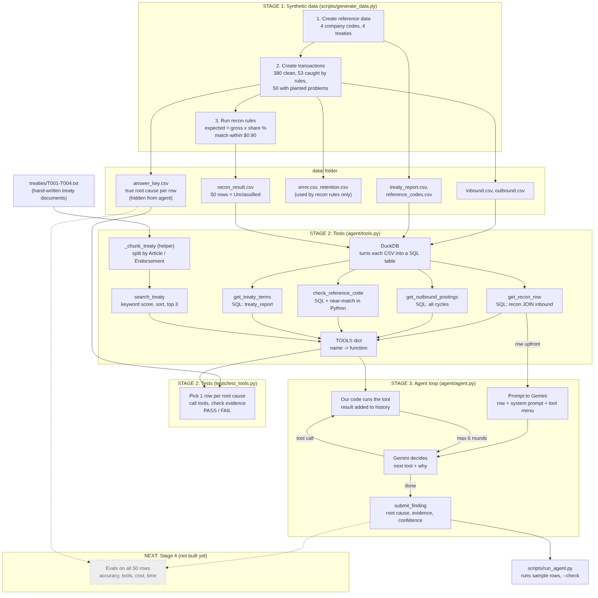

# Recon Exception Investigator: an AI agent for reinsurance reconciliation

An AI agent that investigates **Unclassified** reconciliation exceptions the way an analyst would: it checks postings, validates codes, compares the system's treaty setup with the treaty document, and suggests a **root cause with evidence**. An analyst accepts or corrects it. The agent never closes a row on its own.

> Built on **fully synthetic data**. No client names, codes or data.



## The problem
A rule-based recon compares expected vs actual ceded amounts every cycle. Rows that no rule explains are left **Unclassified**, and analysts investigate each one by hand. The same root causes keep recurring, and the knowledge of how to resolve them lives in people's heads.

## What the agent does
1. Receives an Unclassified row (expected, actual, variance, treaty, company code).
2. Chooses which tools to call, and explains why each time:
   | Tool | Finds |
   |---|---|
   | `get_outbound_postings` | Postings in a later cycle (timing) or posted twice (duplicate) |
   | `check_reference_code` | Invalid company codes and likely typos |
   | `get_treaty_terms` | The treaty as set up in the system (share %, dates) |
   | `search_treaty` | The treaty document, including endorsements |
3. Submits one of 6 root causes with evidence and confidence, or **Needs analyst** when the evidence isn't conclusive.
4. A **code guardrail** rejects the riskiest label (treaty amendment) unless an endorsement was actually retrieved.

## Results (50 Unclassified rows with a known answer key)
| Version | Accuracy | Unclear rows escalated | Confidently wrong | Tool calls/row | Sec/row |
|---|---|---|---|---|---|
| v1 baseline | 96% (48/50) | 3/5 | 2 | 2.2 | 9.1 |
| **v2 + guardrail (3 runs)** | **99.3% (149/150)** | **15/15** | **0** | 1.8 | 7.3 |
| v2 via MCP | 100% (50/50) | 5/5 | 0 | 1.8 | 7.5 |

**What changed from v1 to v2:** both baseline errors were unclear rows labelled *treaty amendment* with high confidence, even though the agent's own evidence said no endorsement existed: a reasoning failure, not a retrieval one. v2 added a stricter prompt (an amendment needs an endorsement **and** matching numbers), a self-check before submitting, defined confidence levels, and the code guardrail.

Full reports: [`results/`](results/) · Eval method and analysis: [`docs/stage-4-evals.md`](docs/stage-4-evals.md)

## Key design decisions
| Decision | Why |
|---|---|
| Narrow tools, not a "run any SQL" tool | Safer, auditable, easy to evaluate |
| Final answer is a tool with a fixed list of causes | Structured, measurable output |
| Required `why` on every tool call | Visible reasoning and an audit trail |
| "Needs analyst" as a valid answer | For a financial control, an honest "unsure" beats a confident guess |
| Prompt fix **and** code guardrail | Prompts can be ignored; a code check can't |
| Plain Python loop, no agent framework | Single agent, simple flow; every step visible and debuggable |
| Keyword retrieval, no embeddings | Evals showed retrieval found 100% of amendment clauses; failures were reasoning |
| Tools also served over **MCP** | Any MCP client (e.g. Claude Desktop) can reuse the same tools |
| Retry + fallback model | Keeps batches running when the main model is busy or rate-limited |

## Tech stack
Python · Gemini API (function calling) · DuckDB · MCP Python SDK · Streamlit

## Run it
```bash
pip install -r requirements.txt
echo "GEMINI_API_KEY=your-key" > .env
echo "GEMINI_MODEL=gemini-3.5-flash-lite" >> .env

python3 scripts/generate_data.py                 # synthetic data (already included)
python3 scripts/run_agent.py --sample 5 --check  # watch the agent investigate
python3 scripts/run_evals.py                     # full 50-row eval
TOOL_SOURCE=mcp python3 scripts/run_evals.py     # same eval through the MCP server
streamlit run app.py                             # the UI
```
Tests (no API key needed): `python3 tests/test_tools.py`, `python3 tests/test_agent_loop.py`, `python3 tests/test_mcp.py`

## Project structure
```
agent/         tools.py (lookups), agent.py (loop, guardrail), prompts.py (v1, v2), mcp_tools.py (MCP client)
mcp_server/    server.py (tools over MCP)
scripts/       generate_data.py, run_agent.py, run_evals.py
data/          synthetic recon data, treaty documents, answer key
tests/         tools, agent loop (fake LLM), MCP
results/       eval reports
docs/          stage-by-stage notes and architecture
app.py         Streamlit UI
```

## Limitations and next steps
- **Synthetic data:** 5 planted causes, one cause per row, 50 cases. Real exceptions are messier (multiple causes, unseen causes).
- **Next:** test on anonymised real exceptions with analyst labels; allow multiple causes and an "Other" category; hybrid retrieval for long, real treaties; feed accepted/corrected findings back as labels for a cheaper ML classifier on common patterns; graduate reliable patterns into deterministic recon rules.
